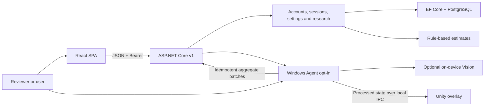
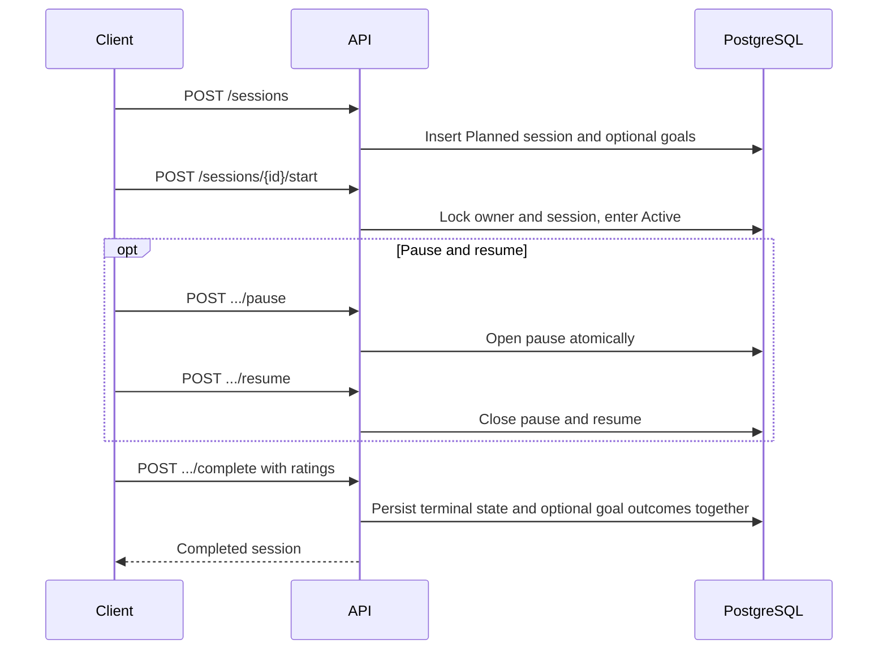

# API contract guide

Start with [Getting Started](getting-started.md), then follow the [integration tutorial](integration-tutorial.md). Use [OpenAPI 3.1.1](openapi.json) to look up schemas, allowed values, authentication and request and response examples. The [generated coverage index](operation-coverage.md) maps all 42 application operations. Operational routes /health/live and /health/ready are separate. /openapi/v1.json is enabled in Development and Contract. The versioned JSON is suitable for offline review.

## System context



## Auth and ownership

Register, log in, use the returned access token, and replace both credentials after a successful [refresh](authentication.md). OpenAPI marks three anonymous operations and 39 Bearer-protected operations. Settings, results and telemetry are scoped to the identity attached to the validated credential. Using a foreign session, profile or goal identifier returns 404. Keep secrets out of URLs, logs and examples. Credential strings used in the checked-in examples are illustrative placeholders. Generate your own disposable values.

## Collection queries and dates

Query bounds use ISO 8601 instants and UTC offsets. The lower filter is inclusive and the upper filter is exclusive. History sorts by effective start or creation timestamp and then session UUID. Page starts at 1, PageSize defaults to 25, and the default configured maximum is 100. An empty page can still have a nonzero totalCount. If a record is added between requests, offset pagination can shift rows. Restrict the window and deduplicate by resource ID when exporting an actively changing collection.

The summary endpoint returns one interval. Statistics accepts Day, Week or Month and an IANA time zone. Calendar buckets are laid out in the requested zone. The start and end values are instants and may reflect daylight-saving transitions. Missing ratings stay null. Human check-ins, observed counters, and estimated states are separate measures.

## Session lifecycle



Use Cancel on an eligible unfinished session. Planned goal edits and started outcomes have different rules. Invalid transitions return 409. For a retry after a network interruption, read the resource state before repeating a lifecycle command. A successful 204 has no body.

## Agent and Vision

1. Authenticate and select one owned, started session. Obtain separate desktop or camera consent. The Agent still requires its own explicit Windows opt-in.
2. Send timestamps and a newly assigned clientEventId for each observation window. Persist the payload and reuse the exact ID and content if delivery is uncertain. Replays increment duplicates. A changed payload under the same ID fails with 409.
3. Batch processing is transactional. Distinct desktop and camera streams may overlap one another. Windows in the same stream may not overlap. The server checks the session/consent boundary, pause handling and upload age. A 422 response requires correcting or discarding the ineligible window.
4. Desktop records contain counters and optional process names. A camera row has no process name, all desktop counters at zero and a vision object containing coarse duration totals and sample counts. Present plus notDetected plus unknown equals the interval length in milliseconds. Facing plus away cannot exceed present. No frames, facial landmarks or biometric identifiers belong in the payload.
5. Read desktop observations, versioned state estimates, the separate vision summary or the combined timeline from the owner-scoped endpoints. The experiment uses qualifying overlapping observations when enabled. It does not establish that a person was attentive.

See the full request schema and a captured mixed-stream batch in [OpenAPI](openapi.json). Read [Vision privacy](../vision/privacy.md) for local/trust boundaries.

## Recovery and status codes

See [Error handling](error-handling.md). All documented 4xx/5xx responses have a Problem Details example. The fixture executed typical malformed input, credential, unsupported media, missing owner resource, conflict and time-window cases. Shared examples for the remaining cases illustrate the envelope. They are not claims that production emitted those responses on every route. Recover by checking the allowed state, fixing inputs, renewing valid credentials, or applying bounded retry for 429/5xx. Record the trace ID for support only.

## Change protocol

1. Change DTOs/controller response annotations first. Keep versioning rules in [Versioning](versioning.md). Keep operation notes and redacted fixtures in the two embedded Contract JSON files. Add a [changelog](changelog.md) entry.
2. Regenerate via the live contract test. Run the schema validator, the documentation gate and the frontend type generation. Review descriptions, documented nullability and wire compatibility.
3. Capture new endpoint examples with a clean synthetic fixture. Keep token and password placeholders in version control. Review examples for accidental personal data.
4. Commit the regenerated exact contract, coverage matrix and generated types together. CI fails on drift or invalid examples.

```powershell
$env:FOCUS_EXPORT_OPENAPI = '1'
dotnet test Focus.Api.IntegrationTests -c Release --filter 'FullyQualifiedName~ContractTests'
Remove-Item Env:FOCUS_EXPORT_OPENAPI
python -m pip install openapi-spec-validator==0.7.2
python -m openapi_spec_validator docs/api/openapi.json
python scripts/check-api-documentation.py --write-report
npm --prefix Focus.Web run api:generate
```

To reproduce the fixture capture, use an isolated PostgreSQL service on a non-default loopback port with a disposable test database name. Set FOCUS_TEST_DATABASE to that fixture connection, build the Release API, and run `python -B scripts/capture-api-examples.py Focus.Api/bin/Release/net10.0/Focus.Api.dll artifacts/api-capture.json`. The command creates a new isolated database and removes the synthetic account at the end of the successful flow. The capture file is reviewed input to ContractExamples.json. Keep capture logs in ignored artifacts.
