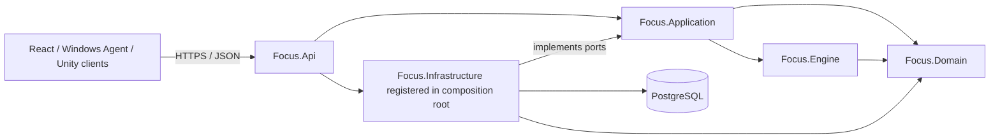
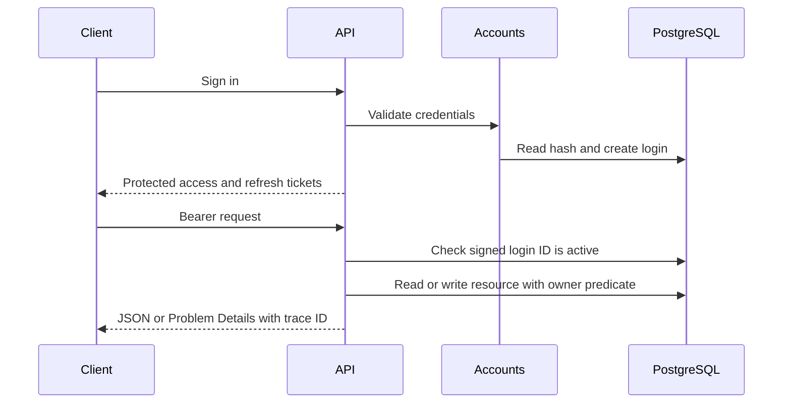
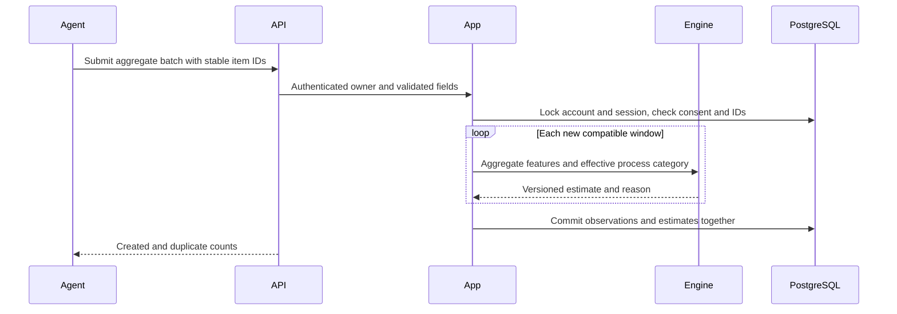
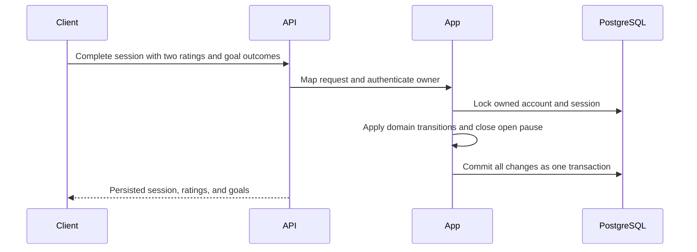

# Backend architecture

ASP.NET Core translates HTTP contracts into application operations. Application owns
workflow orchestration and persistence contracts. The domain owns lifecycle rules
and has no HTTP, EF Core, or database dependencies. Infrastructure implements the
application contracts using PostgreSQL and is registered by the API composition root.

## Decisions

- Continue as one server deployment. Resource ownership and atomic session/telemetry
  changes currently benefit from a common PostgreSQL transaction boundary.
- Use controllers and the `/api/v1` prefix. The previous host had no business routes.
- Publish Problem Details with a request trace identifier. Internal exception text and
  rejected input values do not belong in API error bodies.
- Keep the original migrations intact. Apply new migrations in an explicit job.
- Keep the Windows collector separate from the server and preserve the distinction
  between observed events, heuristic estimates, goal outcomes, and self-reports.

## Components and dependencies

Read models expose separate HTTP projections. Scoped EF adapters share one
context per request. API errors are translated at the HTTP boundary. The engine
depends on the domain's enums and evaluates pure data. Application uses the engine
directly because it is a deterministic in-process module without I/O.

## Authentication and request lifecycle

## Telemetry ingestion

## Session completion

