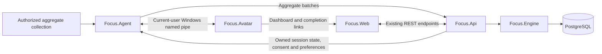

# Windows desktop companion architecture

## Boundaries

| Component | Responsibility |
| --- | --- |
| `Focus.Agent/Sync/LocalAvatarPipe.cs` | Local Windows pipe with a current-user SID access rule, first-instance ownership and OS-level remote client rejection. |
| `Focus.Agent/Sync/AvatarBridge.cs` | Bounded request/response and command allowlist. Agent's API requests still go through existing bearer authentication and session ownership validation. |
| `Focus.Agent/Sync/AgentApi.cs` | Reads the owner's current state, consent and preferences. Submits the existing start, pause and resume commands. |
| `Focus.Avatar/Assets/Runtime/Protocol` | Shared frame format, validated wire fields, estimate-to-expression mapping and visibility policy. |
| `Focus.Avatar/Assets/Runtime/AvatarConnection.cs` | Local pipe client. Before sending, validates the server owner's Windows SID against its own SID. Opens with anonymous impersonation. |
| `Focus.Avatar/Assets/Runtime/SessionController.cs` | Main-thread presentation state, asynchronous commands, retry backoff and observed-completion reaction. |
| `Focus.Avatar/Assets/Runtime/AvatarController.cs` and `AvatarView.cs` | Unity scene composition, compact desktop panel, commands, settings and browser navigation. |
| `Focus.Avatar/Assets/Runtime/Animation/AvatarAnimator.cs` and `OrbitCharacter.cs` | Reusable 2D pose state machine, eased transitions, sprite rendering and visor animation. |
| `Focus.Avatar/Assets/Runtime/WindowsOverlay.cs` | Win32 positioning, transparency, reversible click-through, drag, hotkey and window cleanup. |

## Pairing and data flow

The session UUID selects a pipe. Windows account identity is the local
authorization boundary. Software already running as that same Windows user
has that user's access to a live bridge. Stop Agent with Ctrl+C to end pairing.
Agent credentials stay in Agent memory. The IPC payload contains session
status, one pending goal, consent status, visibility and notification intensity,
the recent processed estimate and rule version if available, and optional
active and planned seconds from the existing owned-session API. It carries no
browser sessions, tokens or raw activity. Process name is also omitted. The
pipe accepts frames up to 8 KiB, one request per connection, and only snapshot,
start, pause and resume verbs.

Unity normally requests a snapshot two seconds after receiving the previous
one. It retries after two, four and up to eight seconds when offline. The
Agent bounds each exchange. In the standard Agent workflow a full activity
window takes around 15 seconds to aggregate. Windows capture, upload,
API scheduling and the next poll all affect observation-to-avatar delay.
The companion suppresses estimates over 45 seconds old and clears the
current estimate and goal if it loses access. These timings are policies,
not a physical end-to-end latency measurement.

The timer uses the API's active duration and extrapolates by at most three
seconds between polls for an active session. Paused or completed values stay
fixed until another authoritative snapshot. An older Agent without timing
fields still connects and displays a dash for time.

The avatar maps all six estimates to procedural expressions. A paused session
uses a relaxed expression even without an estimate. Celebration is temporary
and only follows a completion observed after an active or paused state.
Visibility and notification intensity come from account preferences. Controls
can always be explicitly opened. The first release renders one original
character, regardless of the optional saved avatar identifier. Estimates
represent heuristics, while concentration and productivity ratings remain
self-reported. Tired and Disconnected are presentation poses with no new
Focus Engine meanings. See the [visual design](desktop-visual-design.md).
