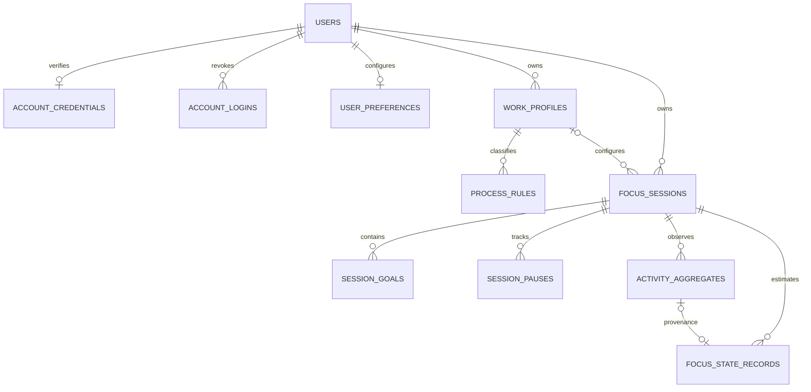

# PostgreSQL OLTP verification and normalization

This record follows the eight EF migrations through `20261123161834_AddCameraObservation`. The historical dictionary and schema remain available. Use the [catalog-derived dictionary](oltp-data-dictionary.md) for all 12 tables including EF history, 72 columns, 28 named PK/FK/UNIQUE/CHECK constraints and 30 indexes. Terms below use the assignment rubric and the repository audit. The original signed university rubric was unavailable.

## Logical schema



The profile FK includes the session UserId. Estimate provenance includes the session ID and aggregate ID. Cascading ownership relationships and the nullable legacy fields are listed in the physical dictionary. Profile deletion is restricted while referenced. The application filters by account on every private query. This is service enforcement and referential protection, with no claim of PostgreSQL RLS on all tables.

## Functional dependencies and 3NF

The analysis treats a record as an identified fact at write time. An FD X → Y means any two legal tuples agreeing on X agree on Y. 3NF requires a nontrivial FD determinant to be a superkey or the dependent attribute to be prime.

| Relation | Candidate key and intended dependencies | Assessment |
|---|---|---|
| Users | Id and unique non-null Email each determine the user fields | Name, creation and consent state belong to one account. Consent timestamps encode the active acceptance boundaries. |
| AccountCredentials | UserId and unique NormalizedEmail each determine credential fields | PasswordHash is an ASP.NET Identity hash, never a password. The normalized email is a deliberately stored lookup projection of Users.Email, maintained by the account workflow. PostgreSQL enforces each unique index. Cross-table normalization semantics are application-enforced. |
| AccountLogins | Id determines owner, expiry and family. Non-null legacy-compatible (UserId, FamilyId) is unique | Rotation preserves family identity and replaces a pair. Nullable legacy family values are outside that alternate uniqueness claim. |
| UserPreferences | UserId determines schedule and avatar preferences | Single row per account. Durations are in minutes, and interval count governs long-break cadence. |
| WorkProfiles | Id determines owner, name and default durations | (UserId, Id) supports the ownership FK and is a superkey, with Id as the minimal key. No user attributes copied into the profile. |
| ProcessRules | (WorkProfileId, ProcessName) determines Category | Category varies by profile. No rule is determined by the process name alone. |
| FocusSessions | Id determines owner, times, status, ratings, reflection and optional profile | The profile reference does not copy the profile configuration; UserId participates in the ownership FK. Session state is a stored lifecycle fact and cannot be derived uniquely from timestamps alone. Dynamic elapsed time is computed, not materialized. |
| SessionGoals and SessionPauses | Id determines the parent session and the item's values | Separate relations avoid repeated goal or interval columns. A filtered unique index allows only one open pause. |
| ActivityAggregates | Id determines parent session, window and observed measurements. (FocusSessionId, ClientEventId) is unique when the client ID is present | Typed counters are observed facts. The JSONB Vision value deliberately stores one atomic immutable camera measurement. Its coarse members are not relationally normalized inside JSON. The database rejects a mixed desktop/camera row. |
| FocusStateRecords | Id determines interval, state, rule version and provenance; a non-null ActivityAggregateId is unique | Session ID and interval are repeated for provenance and timeline filtering. The composite FK enforces the same session, while application code records the corresponding interval. InputProcessCategory and RuleVersion preserve historical interpretation if a profile changes. |
| EF history | MigrationId determines ProductVersion | Infrastructure metadata, separate from application data. |

These are the intended dependencies under existing keys. Optional uniqueness is not a universal candidate key for null-bearing historical tuples. The constrained projections and copied provenance are explicit exceptions to a pure normalized representation. There is no claim that arbitrary JSON subfields or all API invariants are enforced by database check constraints.

Status domains are documented in the [backend addendum](backend-v1.md). Values are integer-backed in PostgreSQL and named strings on the wire. Application checks enforce rating ranges, time-zone normalization, pause boundaries, same-stream nonoverlap and consent. Existing SQL checks enforce pause ordering and camera-only shape. The authoritative SQL vocabulary is the [idempotent migration script](oltp-schema.sql).

## Integrity, roles and tests

- Release integration tests exercise FK ownership, filtered open-pause uniqueness, idempotent client IDs, rejection of contradictory input, rollback when a second window is invalid, token revocation and user isolation. Vision upgrade tests migrate through TrackLoginFamily, write a legacy row, advance to the camera migration and assert disabled-by-default consent.
- The idempotent DDL applied successfully twice on a fresh loopback fixture. Npgsql and EF build a real schema. The exported catalog matches 12/72/28/30 counts above.
- An isolated managed-role analogue used focus_migrate as owner and focus_runtime as reader/writer. After a new table was created by the migrator, the versioned grant script added runtime permissions. An INSERT set the test row count to 1 and rollback returned it to 0. The runtime role read all eight EF history rows and was denied schema CREATE. The runtime check also verifies history write denial.
- Identity hashes are stored outside profile data. The synthetic seed defines no credentials and creates no login-able accounts.
- Run `pg_dump -Fc` and `pg_restore --exit-on-error --no-owner --no-acl` only against disposable or authorized targets. A synthetic backup restored eight migrations, 15,000 sessions and 105,000 observations in 2.93 seconds on this machine. Restore SQL roles intentionally on the target, then verify permissions and data. This is a fixture timing, not a production RTO.
- For actual managed PostgreSQL, use staged PITR, backup access control and an encrypted independent archive per the [managed runbook](../deployment/managed-cloud.md#external-verification-and-recovery). Do not downgrade EF automatically or overwrite a live cluster during recovery.

## Query and index evidence

The [seed](oltp-seed.sql) deterministically creates 100 synthetic reviewer accounts, 15,000 sessions and goals, 105,000 windows and 90,000 estimates and is idempotent. [The probes](oltp-plans.sql) use application ownership predicates and chronological orderings. They evaluate representative SQL pieces and do not measure HTTP latency or the full EF split-query detail hydration.

| Query | Measured execution | PostgreSQL plan |
|---|---:|---|
| Session history, current indexes | 0.202 ms | Owner-prefix bitmap index lookup followed by filter and sort on effective start |
| Owned goal detail | 0.067 ms | Session PK plus index on SessionGoals.FocusSessionId |
| Desktop aggregate window page | 0.171 ms | Session PK and session prefix of the client-event index; desktop filter and bounded sort |
| Vision aggregate input | 0.067 ms | Session PK and session prefix of the same index; filters Vision IS NOT NULL |
| Date-range owned analytics observations | 1.504 ms | Owner prefix then nested index lookups on (FocusSessionId, StartedAt), 1,295 shared buffer hits at root |
| Session history, candidate expression index | 0.056 ms | Reverse index scan on (UserId, COALESCE(StartedAt, CreatedAt), Id), no explicit sort |

Values are one instrumented PostgreSQL 17 fixture run. The candidate expression index was created and rolled back in that test transaction. There was no production schema/index change. The observed saving was about 0.15 ms for the selected history query. Retain the existing indexes until a representative larger deployment profile supports the write/storage tradeoff. The idempotency and ownership indexes enforce integrity in addition to access speed. Real insert costs and multi-user throughput are unmeasured. No triggers, projections or materialized views were added.

## Reproduce without personal data

From a Release checkout with the matching EF CLI:

```powershell
dotnet ef migrations script --idempotent --project Focus.Infrastructure --startup-project Focus.Api --configuration Release --output artifacts/task20/focus-schema.sql
```

Create the new `focus_test_task20_ddl` database on the dedicated local fixture cluster. The following uses explicit test host and port. `$role` is the disposable cluster login.

```powershell
$o = @('-h','127.0.0.1','-p','55454','-U',$role,'-d','focus_test_task20_ddl','-X','-v','ON_ERROR_STOP=1')
psql @o -f docs/database/oltp-schema.sql
psql @o -f docs/database/oltp-schema.sql
psql @o -Atq -o artifacts/task20/catalog.json -f docs/database/oltp-introspect.sql
python -B scripts/render-oltp-dictionary.py artifacts/task20/catalog.json
psql @o -f docs/database/oltp-seed.sql
psql @o -f docs/database/oltp-plans.sql
psql @o -q -o artifacts/task20/synthetic-demo.csv -f docs/database/oltp-demo-export.sql
```

The demo export works only on the named fixture and accepts only the synthetic seed address pattern. It outputs date buckets, counts and means. Email, UUID, names, free text, exact session times and raw activity are excluded; no personal data is needed for the demo. The user-authorized private account export remains separate. Real research extracts require access control, retention approval and a disclosure review.
