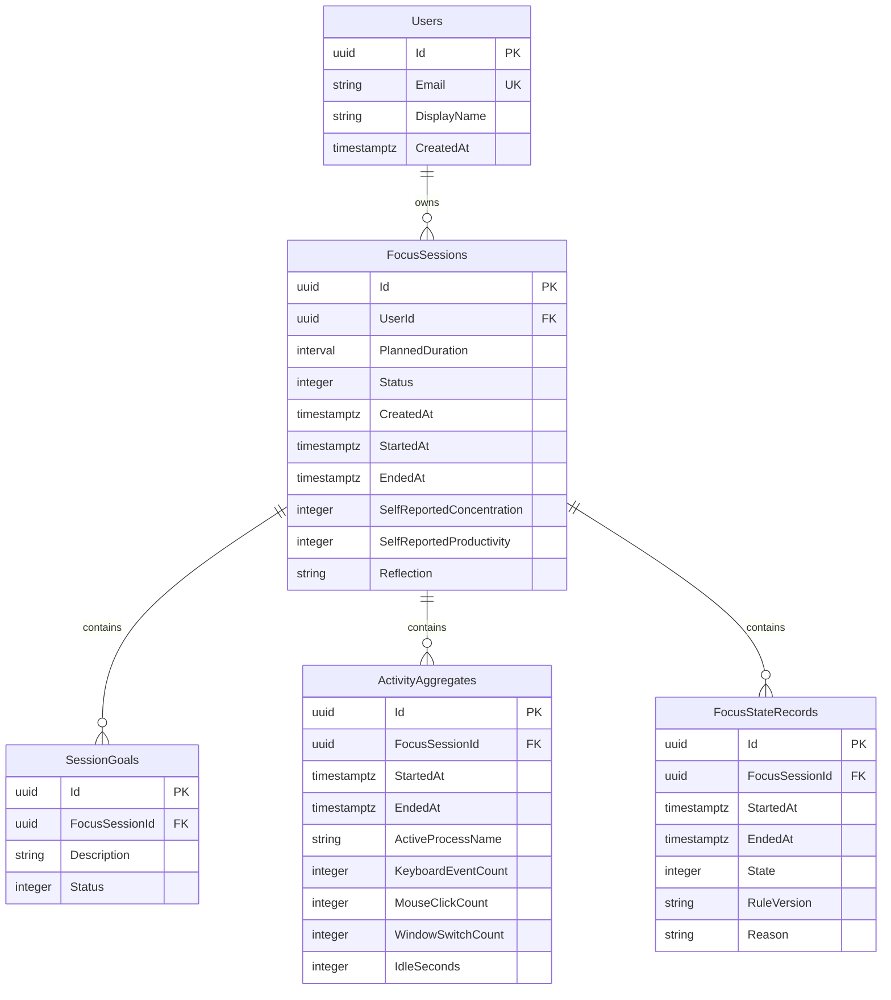

# Focus Assistant — Database Schema

The core schema below records the historical two-migration baseline. The
[backend v1 schema addendum](backend-v1.md) describes the additional tables and
relationships.

## 1. Database Architecture

Database management system: PostgreSQL 17

Data access: Entity Framework Core with Npgsql

Main database: focus_assistant

The database supports five core entities:

1. Users
2. FocusSessions
3. SessionGoals
4. ActivityAggregates
5. FocusStateRecords

Entity relationships are configured using EF Core Fluent API.

## 2. Entity-Relationship Diagram



## 3. Relationships

### Users → FocusSessions

Type: One-to-Many

Foreign key: FocusSessions.UserId

Each focus session belongs to one user.
One user can create multiple sessions.

Delete behavior: Cascade.

### FocusSessions → SessionGoals

Type: One-to-Many

Foreign key: SessionGoals.FocusSessionId

A session can contain multiple goals.

Delete behavior: Cascade.

### FocusSessions → ActivityAggregates

Type: One-to-Many

Foreign key: ActivityAggregates.FocusSessionId

Each session can have multiple activity intervals.

Delete behavior: Cascade.

### FocusSessions → FocusStateRecords

Type: One-to-Many

Foreign key: FocusStateRecords.FocusSessionId

Each session can have multiple estimated focus states.

Delete behavior: Cascade.

## 4. Research Data Flow

The research workflow is based on the following process:

1. A user creates and starts a focus session.
2. Focus.Agent collects computer activity.
3. Aggregated activity is stored in ActivityAggregates.
4. Focus.Engine estimates concentration states.
5. Estimates are stored in FocusStateRecords.
6. After the session, the user reports concentration and productivity.
7. Self-reported ratings are stored in FocusSessions.
8. Statistical analysis compares activity features and ratings.

This design allows researchers to compare estimated states with user feedback.

It does not assume that keyboard activity or mouse clicks directly measure productivity.

## 5. Database Creation

The database schema is created through EF Core migrations rather than manual table creation.

Run the following commands from the solution root.

List migrations:

```powershell
dotnet ef migrations list --project Focus.Infrastructure --startup-project Focus.Api --context FocusDbContext
```

Apply migrations:

```powershell
dotnet ef database update --project Focus.Infrastructure --startup-project Focus.Api --context FocusDbContext
```

Required environment:
- .NET SDK compatible with the solution
- PostgreSQL server
- EF Core CLI tooling
- A configured PostgreSQL connection string

The connection string must be provided through secure local configuration or environment variables.

Passwords and other secrets must not be committed to Git.

## 6. Database Design Decisions

- UUID primary keys identify application records.
- Foreign keys preserve entity relationships.
- Cascade deletion removes dependent records.
- Timestamps are stored using PostgreSQL timestamp with time zone.
- Activity metrics are stored as aggregates.
- Personal text input is not collected.
- Concentration and productivity ratings are stored separately.
- Algorithm versions are recorded for reproducibility.
- Database changes are versioned using EF Core migrations.

## 7. Current Limitations

The current schema does not yet include dedicated tables for optional computer vision features.

Offline SQLite synchronization is part of the wider system design but is not represented by these PostgreSQL migrations.

Some business validation rules are enforced in C# rather than through database CHECK constraints.

The schema can be extended through additional migrations.
