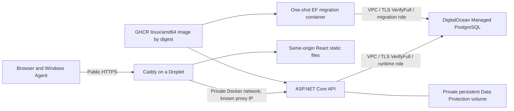
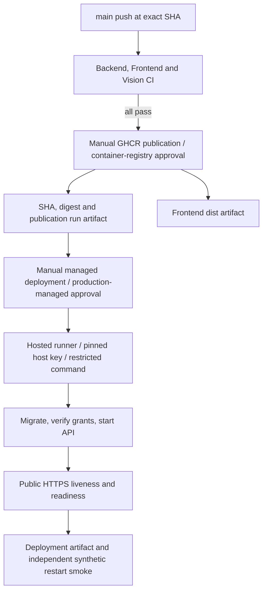

# Managed cloud release on DigitalOcean

This runbook follows the green application checkpoint `7c62bf56c3b3d922299f2d95434701ff47556577`. The managed deployment configuration is a separate infrastructure change. Use the locally and remotely checked infrastructure SHA for publication. The older single-host PostgreSQL runbook remains an alternative for local/self-managed operation.

## Provider decision and monthly budget

Prices checked on November 23, 2026, in USD before taxes, optional fees and usage. Confirm the actual plan and region before approval.

| Option | Published base price and limitations | Project fit |
|---|---|---|
| DigitalOcean Regular Basic Droplet and Standard Managed PostgreSQL | 2 GiB Droplet $12 plus single-node 1 GiB database from $15, **$27/month**. A 1 GiB Droplet makes the arithmetic floor $21, with less deployment headroom. Paid plans. Single-node is not HA. | Recommended. Reuse Caddy, existing container, persistent volumes, same-origin React, and a private VPC database with full certificate verification. Provider operates PostgreSQL and automated backups. Owner maintains the Droplet. [Droplet pricing](https://www.digitalocean.com/pricing/droplets), [database pricing](https://docs.digitalocean.com/products/databases/postgresql/details/pricing/) |
| Render Starter and Render Postgres | $7 web plus $6 Basic DB compute, plus applicable storage/overage and a paid persistent disk for the current key-ring strategy. Free web sleeps after 15 minutes and has no persistent disk. Free DB expires after 30 days. | Real managed DB and simpler public URL. A migration privilege boundary and trusted HTTPS forwarding need a different tested design. Render internal DB TLS supports `require` with certificates that do not support `verify-full`. [Pricing](https://render.com/pricing), [free limits](https://render.com/docs/free), [internal connection TLS](https://render.com/docs/postgresql-creating-connecting) |
| Railway Hobby and PostgreSQL | $5 monthly minimum credited toward usage. Compute, storage and traffic can increase the total. Free tier has usage limits and sleep. | The basic template is a container and volume. Railway describes managed coverage for eligible high-availability configurations with backup or PITR and pooling. Confirm its managed operating boundary and price before considering it for the rubric. [Plans](https://docs.railway.com/pricing/plans), [Free](https://docs.railway.com/pricing/free-plan), [database responsibilities](https://docs.railway.com/databases) |

Use one Droplet and one managed database in the same region and VPC, and an existing approved DNS name. Domain registration, extra storage, transfer, registry retention and optional VM snapshots can cost extra. Set spend-alert notifications at 50%, 80% and 100% of an owner-approved operating budget. Alerts are notifications, not a cap. Keep resources through the agreed review dates, then stop authorized rollout access, export approved data and remove only the approved resources. [Spend alerts](https://docs.digitalocean.com/platform/billing/spend-alerts/)

## Topology



ASP.NET Core uses protected bearer access and refresh tokens. There is no JWT signing key to configure. Keep the Data Protection volume and Caddy certificate volumes across recreations. The API runs non-root with no published port. Public HTTP ingress terminates at Caddy, which HTTPS-redirects. Only the fixed Caddy IP is trusted for forwarded headers. Keep same-origin SPA and API. The configured CORS origin is that HTTPS hostname. Windows Agent, Unity and camera processing remain on Windows.

## Owner approval and provisioning

1. Approve the budget, billing term, data region, DNS name, retention period and review-period availability. In DigitalOcean, create an AMD64 Ubuntu 24.04 LTS Droplet and one Standard Managed PostgreSQL **17** cluster if offered in that region. Put both in the same VPC. Use a new database `focus_production`. Create dedicated database users `focus_migrate` and `focus_runtime` in the provider UI. Do not use the administrative login in the API. Download the provider CA for the Standard cluster.
2. Restrict database Trusted Sources to the Droplet. Use the dashboard's **private hostname and direct port**, usually 25060. Do not expose a database listener from the host, use a public DB connection string, or use a transaction-mode pool for EF migrations. Set the DNS A record and verify it resolves to the Droplet. Permit public 80/443. Restrict management SSH to operator sources. Use a dedicated SSH endpoint for CD through approved private/allowlisted connectivity, or a time-limited key-only ingress window to the dedicated deployment user when a standard hosted runner has dynamic egress. Close the temporary ingress afterward. Do not attach a persistent runner to this public repository. [Trusted PostgreSQL connections and CA](https://docs.digitalocean.com/products/databases/postgresql/how-to/connect/) · [GitHub runner security](https://docs.github.com/en/actions/reference/security/secure-use)
3. Install Docker Engine, Compose plugin **2.24.4 or newer**, PostgreSQL client, Python 3 and systemd credentials tools on the Droplet. On the new host, use `sudo git clone https://github.com/arteomponomarev/FOCUS-ASSISTANT.git /opt/focus`, then `sudo git -C /opt/focus checkout --detach "$RELEASE_SHA"` with the SHA approved for release. Keep the checkout and deployment scripts root-owned and unwritable to the SSH deployment user. Install the downloaded CA at `/etc/focus/postgres-ca.crt` with read permissions for the non-root application and root. Store credentials outside the checkout.
4. Connect as the provider database administrator from the trusted Droplet, selecting the new database explicitly. Use an interactive password prompt or approved secret store. Review, then run the initial role/bootstrap script once.

   ```bash
   psql "host=$PRIVATE_HOST port=$PRIVATE_PORT dbname=focus_production user=doadmin sslmode=verify-full sslrootcert=/etc/focus/postgres-ca.crt" \
     -W -X -f /opt/focus/deployment/bootstrap-managed.sql
   ```

   This adjusts privileges on a new database and existing provider-created roles. It uses no superuser, role creation or database creation commands. If provider permissions are insufficient, stop and diagnose with the database owner. The migration role owns EF objects. Runtime has CRUD on application tables and SELECT-only access to migration history. Before serving, CD runs the grant and runtime privilege checks after EF. Verify the dashboard Trusted Sources and role attributes after provisioning.

## Secrets and host configuration

Prepare three root-only temporary files under `/run` with `umask 077`. Use a local editor with backup/swap files disabled or an approved secret injection mechanism. Never echo credentials into CI, use them as command-line arguments or put them in chat.

| Credential file name | Input |
|---|---|
| `focus-env` | Copy the shape in `deployment/managed.env.example`. Set hostname, reviewed Caddy image digest, and the runtime and migration Npgsql connection strings with `SSL Mode=VerifyFull;Root Certificate=/etc/focus/postgres-ca.crt`. The deployed Compose DSNs and psql services must agree on the private endpoint, database, TLS, CA path and separate role names. |
| `focus-pg_service.conf` | Fill `deployment/managed.pg_service.conf.example`. Keep `sslmode=verify-full` and the direct private endpoint. |
| `focus-pgpass` | Two pgpass records for the same endpoint/database and respective roles. Escape `:` and `\` per pgpass syntax. |

Seal each temporary file using the host key and the matching name. For example, from the root operator shell:

```bash
install -d -m 0700 /etc/credstore.encrypted
systemd-creds setup
systemd-creds encrypt --with-key=host --name=focus-env /run/focus-env /etc/credstore.encrypted/focus-env
systemd-creds encrypt --with-key=host --name=focus-pg_service.conf /run/focus-pg_service.conf /etc/credstore.encrypted/focus-pg_service.conf
systemd-creds encrypt --with-key=host --name=focus-pgpass /run/focus-pgpass /etc/credstore.encrypted/focus-pgpass
rm -f -- /run/focus-env /run/focus-pg_service.conf /run/focus-pgpass
```

Host root and Docker administrators can inspect live container environment. Restrict those privileges and protect host backups. The API gets the runtime connection only. The migration container gets the separate migration connection. Keep key and proxy volumes across restarts and include them in the approved encrypted host backup. The current image supports optional certificate protection for the application key ring if the operator provisions that certificate privately. No CA private key is required for PostgreSQL.

Create an unprivileged login `focus-deploy`, with no Docker group or arbitrary sudo. Install a dedicated key in a root-controlled authorized-keys file for that account. On its authorized-key line use:

```text
restrict,command="sudo -n /opt/focus/deployment/deploy-managed.sh" ssh-ed25519 YOUR_APPROVED_DEPLOY_PUBLIC_KEY
```

Give this account only the following sudo permission, with a root-controlled script. Validate with `visudo -cf` and confirm the deployment key cannot open a shell, allocate a PTY, or forward ports:

```text
focus-deploy ALL=(root) NOPASSWD: /opt/focus/deployment/deploy-managed.sh ""
```

Use a fixed out-of-band Ed25519 server host key (public portion only) from the Droplet. Verify the connection using a preflight from the approved source. The restricted command accepts only source SHA and GHCR digest on stdin, checks revision, then migrates and recreates healthy services. Every rollout serializes on a host lock.

## GitHub approvals and rollout



1. In GitHub use environments `container-registry` and `production-managed`, limited to `main`, with required reviewer approval (and prevent self-review where supported). Keep package access private if required and provision a read-only GHCR credential on the Droplet using a host-approved Docker credential helper or encrypted root storage. GitHub's publication job uses its own package-write token.
2. Add only the deployment SSH private key to the `production-managed` secret `FOCUS_DEPLOY_SSH_KEY`. Add repository/environment variables `FOCUS_DEPLOY_SSH_HOST`, `FOCUS_DEPLOY_SSH_PORT`, `FOCUS_DEPLOY_HOST_KEY` (exact `ssh-ed25519 BASE64` without host prefix or comment) and `FOCUS_PUBLIC_HOSTNAME`. Validate the public hostname matches the compose setting. Database credentials stay on the host.
3. For the exact green `main` SHA approve **Publish reviewed backend image** with `publish=true`. It runs the shared guard across Backend/Frontend/Vision, builds the same-origin frontend, and builds/publishes the API image tagged with the commit SHA. It re-pulls the immutable digest and checks its image revision. Save the `backend-release` receipt and publish run ID. Do not change the receipt.
4. Download the `frontend-release` artifact from the **same run**, check `index.html` and its `assets/`, and install it in a reviewed version directory before switching `/srv/focus/web`. For initial deployment create that path with the correct directory contents. On subsequent releases update files atomically within the existing bind-mounted directory or recreate the proxy after switching a version symlink, since an existing bind mount retains its old target. Maintain the preceding asset directory. This step is operator-controlled. The backend CD and external API smoke can be reviewed independently.
5. Approve **Deploy verified managed-cloud release** with the successful `publication_run` ID and `deploy=true`. The hosted job verifies that run's conclusion, source branch and SHA, rechecks corresponding push CI and only accepts the receipt's canonical GHCR digest. The host verifies the image label, runs EF and SQL permission audit, then starts the stack. GitHub probes public HTTPS. Keep the deployment evidence artifact.

## External verification and recovery

Run from an independent workstation only after deployment. Use an ignored state file and the same generated disposable password in both phases. Commands trigger only private synthetic account data:

```powershell
$origin = 'https://YOUR_APPROVED_HOSTNAME'
New-Item -ItemType Directory -Force artifacts | Out-Null
curl.exe --fail --silent --show-error --head "$origin/login"
curl.exe --fail --silent --show-error --head "$origin/sessions/new"
python -B scripts/smoke-managed.py prepare $origin --state artifacts/managed-smoke.json --vision
# After the authorized operator restarts the API and records both StartedAt values:
python -B scripts/smoke-managed.py verify $origin --state artifacts/managed-smoke.json --cleanup
```

Use normal TLS verification. For the frontend, also register/login through the browser and check dashboard, session, analytics and settings, plus protected navigation. Seed only synthetic telemetry. A failed preparation can leave the synthetic account; use its local fixture email from the state file and delete only that account if cleanup is required.

For the operator restart, decrypt `focus-env` into a root-only file in `/run`, set `FOCUS_API_IMAGE` to the deployed digest, and use:

```bash
focus_compose() {
  docker compose --project-directory /opt/focus --env-file /run/focus-restart.env \
    -f /opt/focus/compose.production.yaml -f /opt/focus/compose.production.managed.yaml "$@"
}
docker inspect --format '{{.State.StartedAt}}' "$(focus_compose ps -q api)"
focus_compose restart api
focus_compose up -d --wait --wait-timeout 120 api proxy
docker inspect --format '{{.State.StartedAt}}' "$(focus_compose ps -q api)"
rm -f -- /run/focus-restart.env
```

A single API instance has a short restart outage. Check public readiness and reread the same session, analytics and CV totals before cleanup. Keep health probes on the approved uptime monitor and alert on disk, memory and readiness. Retain sanitized summaries and review host Docker logs under restricted access.

For rollback, keep the prior verified image digest and SPA. First review compatibility of the old binary with the newest applied database version. With owner approval, use the previous successful publication run and paired SPA only for a compatible schema. EF does not run a downgrade in this workflow. Restore or repair against a separate approved database if a schema repair is needed. Standard Managed PostgreSQL has provider daily backups/PITR for seven days as documented. Rehearse restore to a separate authorized target and retain encrypted logical backups according to the agreed policy. A PITR restore can provision billable infrastructure. [Provider backup and restore](https://docs.digitalocean.com/products/databases/postgresql/how-to/restore-from-backups/)

## Environment and evidence inventory

| Environment | Inputs and evidence |
|---|---|
| Dev | Existing local Compose/test API with isolated local accounts. No registry or cloud writes. |
| Test | GitHub Backend, Frontend, Vision and secret-scan checks, Postgres fixture, coverage/TRX and container smoke. Managed overlay syntax check. |
| Production | Approved provider and domain, private VPC database, GHCR receipt, hosted CD, public health and independent synthetic restart smoke. |

Evidence to retain: exact Git SHA, successful CI URLs, `backend-release/release.json`, `frontend-release` artifact name, reviewed Caddy digest, `managed-deployment-evidence` artifact with migration and UTC time, cloud dashboard evidence with identifiers/secrets redacted, runtime permission result, DNS/TLS output and smoke/restart timestamps. Do not retain the smoke account password, token, fixture IDs or raw logs as public evidence. See the [managed deployment verification record](managed-verification.md) for current status.
