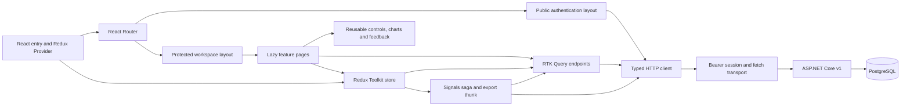

# Focus.Web architecture

Focus.Web is a React and TypeScript SPA built by Vite. The existing ASP.NET Core API owns all durable application state. The frontend does not access PostgreSQL and does not collect desktop activity.

| Layer | Location | Responsibilities |
| --- | --- | --- |
| Application | `Focus.Web/src/app` | Router, protected layout, typed Redux store and theme |
| Features | `Focus.Web/src/features` | Screen composition, feature queries, forms and mutations |
| Boundary | `Focus.Web/src/api` | Generated OpenAPI types, shared RTK Query API, typed requests, authentication and normalized errors |
| Shared UI | `Focus.Web/src/ui`, `Focus.Web/src/styles` | Controls, dialog, status feedback, charts and responsive styles |

The router lazy-loads primary screens. Session controls derive available actions from the latest server status. A monotonic browser timer displays elapsed time between API updates. It does not write timestamps or durations to the database.

See [technology decisions](technology-decisions.md), [state management](state-management.md) and [navigation and user flows](navigation-and-user-flows.md).
