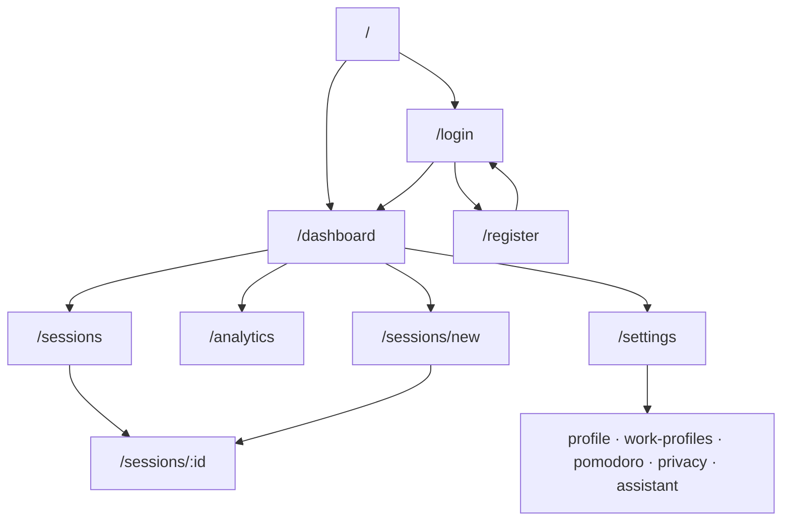
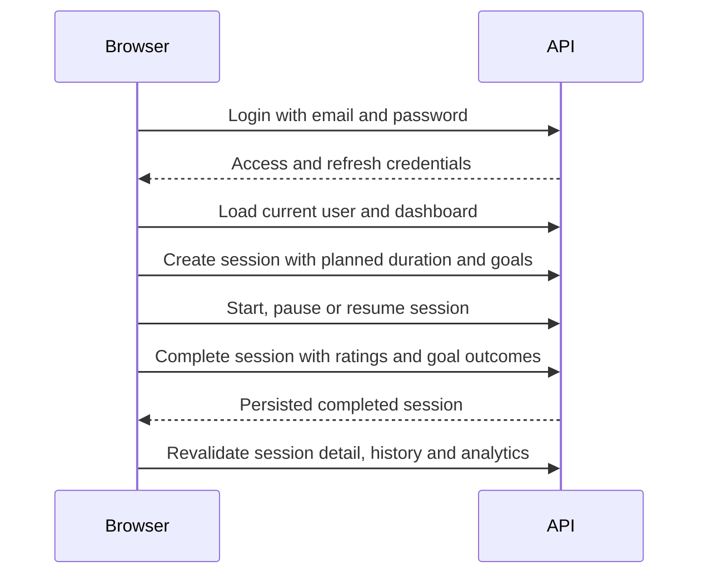

# Navigation and user flows

Valid lifecycle actions follow the server's Planned, Active and Paused states. The completion dialog submits both self-reported ratings and goal outcomes together. The Windows Agent is the source of desktop signals. Web sessions remain usable without desktop telemetry.
