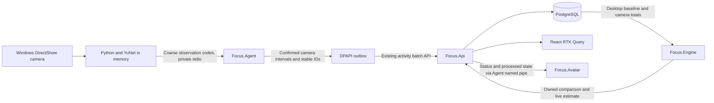

# Focus.Vision architecture



The Agent starts one isolated Python child only for the camera stream. The
worker has no public listener. Its inherited input pipe receives a start
command and renewable lease. Its output pipe accepts fixed one-character
messages for present, not detected, unknown, calibrated facing, calibrated
away and unavailable. No frame, pose coordinate, camera identity or
application credential crosses the pipe. EOF, loss of the lease or Agent
shutdown stops the worker. The Windows driver handle is also released if a
stalled child has to be terminated.

The camera stream shares the Agent's lifecycle checking, 15-second buffering,
encrypted queue implementation, bearer credentials, retry backoff and
idempotent batch endpoint. Camera queue files live under a separate DPAPI
scope directory so revoking either stream keeps the other stream independent.
The server serializes upload with consent and session transitions using the
existing account and session locks. Camera windows and desktop windows can
overlap each other. Same-stream overlap is rejected.

Owned `GET /api/v1/sessions/{id}/vision` returns totals and a reproducible pair
for the latest comparable baseline window. Existing activity, timeline and
estimate readings preserve their desktop semantics. The current-state API
can return the experimental rule version for an active opted-in session.
The camera indicator in Unity comes from the locally authenticated Agent.
The website shows consent and uploaded totals.

## HTTP contract example

The existing bearer-authenticated batch accepts a camera-only item with
the desktop counters zero and the process omitted. The timestamps and
event ID below are illustrative.

```json
{
  "items": [
    {
      "clientEventId": "73c19b54-6129-44c7-982c-e08ba0d4e6ec",
      "startedAt": "2026-11-23T12:00:15Z",
      "endedAt": "2026-11-23T12:00:20Z",
      "keyboardEventCount": 0,
      "mouseClickCount": 0,
      "windowSwitchCount": 0,
      "idleSeconds": 0,
      "vision": {
        "presentMs": 4000,
        "notDetectedMs": 0,
        "unknownMs": 1000,
        "facingMs": 2000,
        "awayMs": 1000,
        "validSamples": 18
      }
    }
  ]
}
```

Upload to `POST /api/v1/sessions/{id}/activity/batch`. The authenticated
settings API accepts `{"cameraEnabled": true}` and optionally
`{"visionExperimental": true}` via `PATCH /api/v1/settings/privacy`.
The complete typed contract is in [OpenAPI](../api/openapi.json).
